# Home {.unnumbered}

Python is a great language for scientific computing, most of the programming done by our group is in python. We provide below some links for learning this language, and below we offer many python code examples. You are invited to download these codes, tweak with them, break them, hack them as you wish!

Most codes focus on plotting, but other algorithms such as numerical integration and Fourier transforms can also be found. 

Some useful links for learning python:

* <a href="http://nbviewer.jupyter.org/github/jakevdp/PythonDataScienceHandbook/blob/master/notebooks/Index.ipynb" target="_blank">Python Data Science Handbook</a>
* <a href="https://learnpythonthehardway.org/book/" target="_blank">Learn Python the Hard Way</a>
* <a href="http://nbviewer.jupyter.org/gist/rpmuller/5920182" target="_blank">A Crash Course in Python for Scientists</a>
* <a href="http://swcarpentry.github.io/python-novice-inflammation/" target="_blank">Software Carpentry</a>
* <a href="http://matthiaseisen.com/fwl/py/" target="_blank">Fun with Lists</a>
* <a href="https://www.codecademy.com/learn/python" target="_blank">Python | Codecademy</a>
* <a href="http://www.scipy-lectures.org/index.html" target="_blank">Scipy Lecture Notes</a>
* <a href="https://github.com/ipython/ipython/wiki/A-gallery-of-interesting-IPython-Notebooks" target="_blank">A gallery of interesting IPython Notebooks</a>
* <a href="http://greenteapress.com/thinkpython/html/index.html" target="_blank">Think Python: How to Think Like a Computer Scientist</a>  
* <a href="https://python-graph-gallery.com/" target="_blank">The Python Graph Gallery</a>  

This might be overwhelming, so I suggest you to follow this:
<blockquote class="twitter-tweet">
My advice on learning Python:  Don&#39;t set out to &quot;learn Python&quot;. Choose a problem you&#39;re interested in and learn to solve it with Python.
&mdash; Jake VanderPlas (@jakevdp) <a href="https://twitter.com/jakevdp/status/906901174728536066?ref_src=twsrc%5Etfw">September 10, 2017</a></blockquote>    

Start by downloading <a href="https://www.anaconda.com/distribution/" target="_blank">Anaconda</a>, a package manager application that will help you get started with python in all platforms.

Make sure you are acquainted with ipython (interactive python, <a href="https://www.pythonanywhere.com/try-ipython/" target="_blank">try it here</a>), and with <a href="http://jupyter.org/" target="_blank">Jupyter notebook</a>.
​

I recommend <a href="https://www.sublimetext.com/" target="_blank">Sublime Text</a> for writing code, and you can install the Anaconda package to it to have a smooth IDE. [not the same anaconda as mentioned above! Yes, it's confusing, I know.]

--------------------------------

## Graph parameters

[Jupyter notebook](/jupyter/graph_params.ipynb){.btn .btn-outline-primary role="button"}

Main features:
The `plot_style.py` file defines parameters for nice-looking graphs.
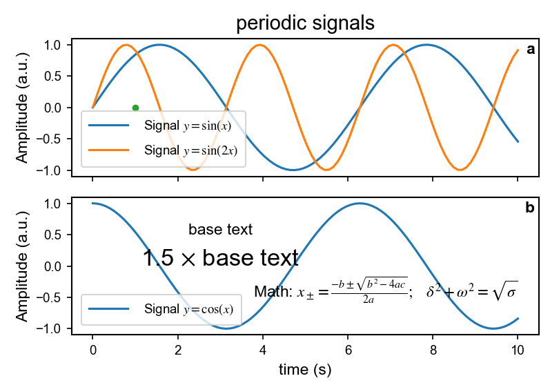

--------------------------------

## Fitzhugh-Nagumo --- Labyrinthine Patterns

[Jupyter notebook](jupyter/fhn.ipynb){.btn .btn-outline-primary role="button"}

Main features: 
how to make a movie, time-integration methods (semi-spectral and Euler)

<iframe width="560" height="315" src="https://www.youtube.com/embed/5au-G5FuI_A" frameborder="0" allow="autoplay; encrypted-media" allowfullscreen></iframe>

--------------------------------

## Conway's Game of Life, acorn initial condition

[Jupyter notebook](jupyter/game-of-life.ipynb){.btn .btn-outline-primary role="button"}

This is a (slightly) modified version of <a href="https://glowingpython.blogspot.co.il/2015/10/game-of-life-with-python.html" target="_blank">Glowing Python</a>'s code. I make it available here because it features a few nice things:

* how to make a movie using matplotlib.animation
* how to write a generator (function with yield)
* how to plot a sparce array (spy)  

Main features:
`matplotlib.animation, yield, with, matplotlib.pyplot.spy`

<iframe width="560" height="315" src="https://www.youtube.com/embed/lelsVltLZe4?rel=0" frameborder="0" allowfullscreen></iframe>

--------------------------------

## Least squares fit of nonlinear function

[Jupyter notebook](/jupyter/least-squares.ipynb){.btn .btn-outline-primary role="button"}

Main features:
`LaTeX text, scipy.optimize.curve_fit, matplotlib.patches`  
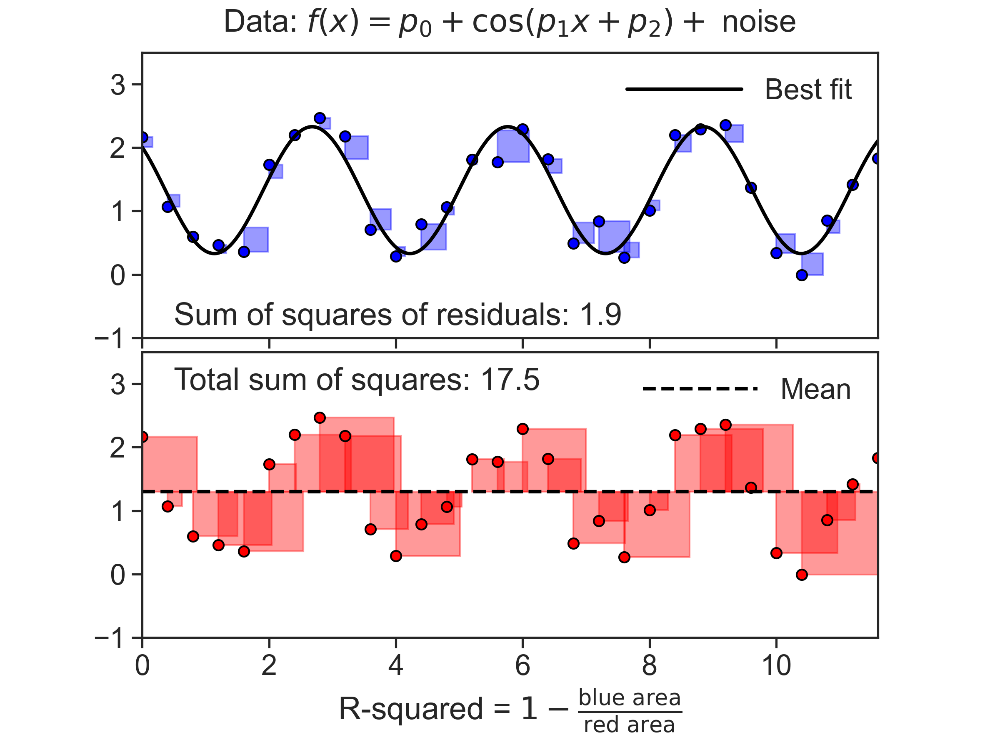

--------------------------------

## Fun with histograms

[Jupyter notebook](/jupyter/histograms.ipynb){.btn .btn-outline-primary role="button"}

Main features:
`np.histogram, plt.hist, plt.bar, plt.barh, gridspec, least squares fit of nonlinear function, plt.hist2d`  
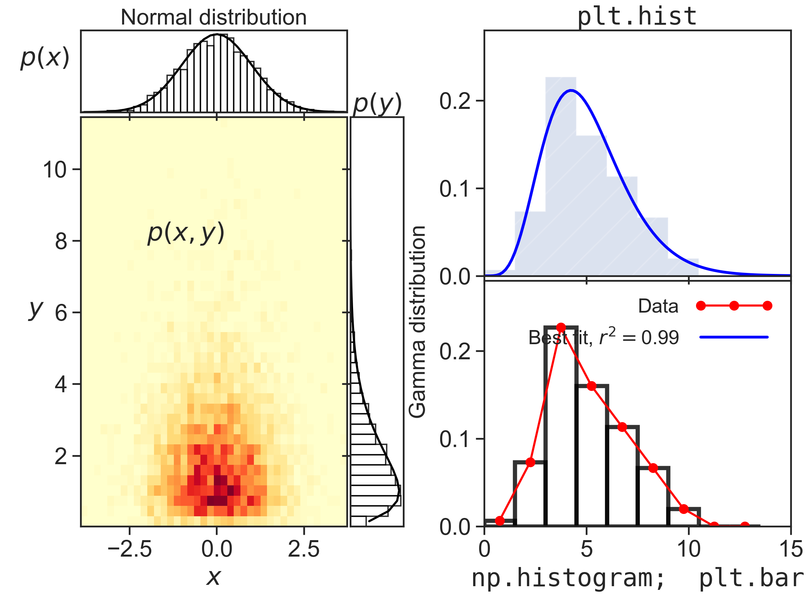

--------------------------------

## Fancy subplot grid

[Jupyter notebook](/jupyter/subplot-grid.ipynb){.btn .btn-outline-primary role="button"}

Highly customizable subplot structure. Also, figure contains several axis configurations and labeling options.  
Main features:
`gridspec subplots; numpy-compatible heaviside; label, ticks and axis manipulations; log scale`
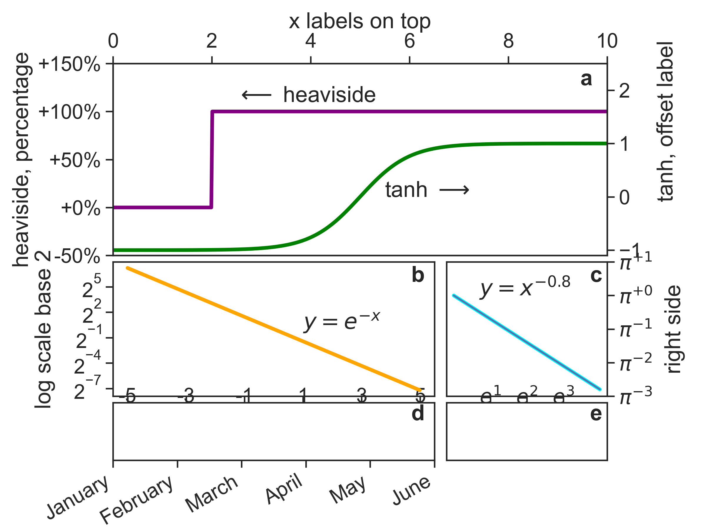

--------------------------------

## Streamplot

[Jupyter notebook](/jupyter/streamplot.ipynb){.btn .btn-outline-primary role="button"}

Streamplot of a two-dimensional linear system, with eigenvectors and nullclines. Python shows LaTeX equations beautifully.  
Main features:
`meshgrid, streamplot, contour, legend, LaTeX`
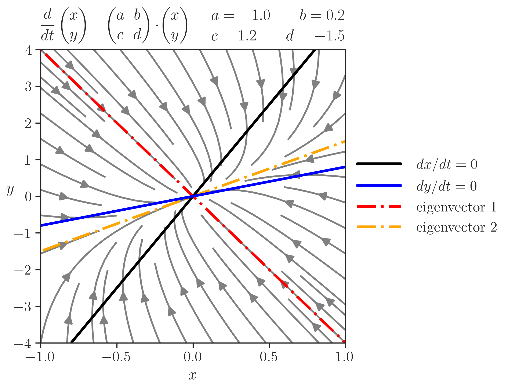

--------------------------------

## Palette

[Jupyter notebook](/jupyter/palette.ipynb){.btn .btn-outline-primary role="button"}

Given a named color, returns palettes with varying hue, lightness, and saturation.  
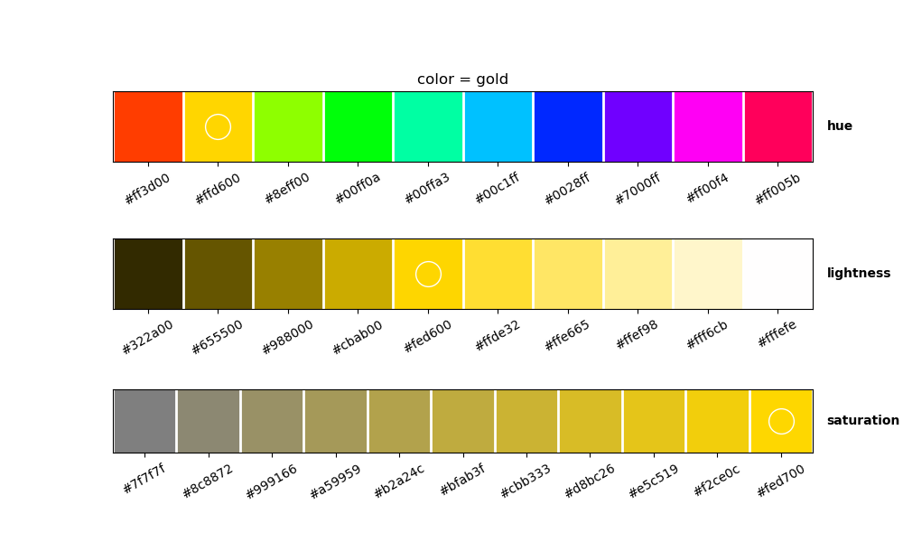

--------------------------------

## The time dependent Ginzburg-Landau equation

[Jupyter notebook](/jupyter/tdgle.ipynb){.btn .btn-outline-primary role="button"}

Numerical integration of a parabolic partial differential equation, using finite differences: Euler step to advance time, and a 5-point stencil to approximate the Laplacian.  
Main features:
`imshow, colorbar, set_data`

<iframe width="560" height="315" src="https://www.youtube.com/embed/JgE9Px7zsQE" frameborder="0" allowfullscreen></iframe>

--------------------------------

## The double pendulum

[Jupyter notebook](/jupyter/doublependulum.ipynb){.btn .btn-outline-primary role="button"}

Numerical integration of the equations of motion of the double pendulum. This time, scipy's ode itegrator was used. Nice example of how to make a movie.  
Main features:
`scipy.integrate.ode, set_data, set_aspect('equal'), remove plot, movie`

<iframe width="560" height="315" src="https://www.youtube.com/embed/-76LN_Kph7A" frameborder="0" allowfullscreen></iframe>

--------------------------------

## The Hilbert curve

[Jupyter notebook](/jupyter/hilbertcurve.ipynb){.btn .btn-outline-primary role="button"}

Construction of the Hilbert curve as a Lindenmayer system (L-system).  
Main features:
`string operations, movie`

<iframe width="560" height="315" src="https://www.youtube.com/embed/Oudyl56GPJU" frameborder="0" allowfullscreen></iframe>

--------------------------------

## A hysteresis mechanism

[Jupyter notebook](/jupyter/hysteresis.ipynb){.btn .btn-outline-primary role="button"}

Hysteresis mechanism created by the bistability of states. System goes to minimum points u in the energy functional $f=u^4-2u^2+hu$. The parameter $h$ is ramped down and up during this simulation.  
Main features:
`sympy analytical calculations, numpy dtypes, movie`

<iframe width="560" height="315" src="https://www.youtube.com/embed/xgRDhOifFow" frameborder="0" allowfullscreen></iframe>

<!-- ------------------------------------- -->
<!-- ------------------------------------- -->

## Contour plot

[Jupyter notebook](/jupyter/contour_plot.ipynb){.btn .btn-outline-primary role="button"}

Contour plot with many customizable options. Also, a nice way to truncate a colormap so it gives the color range that you want.  
Main features:
`truncate_colormap, contour, contourf (fill), clabel (contour label)`

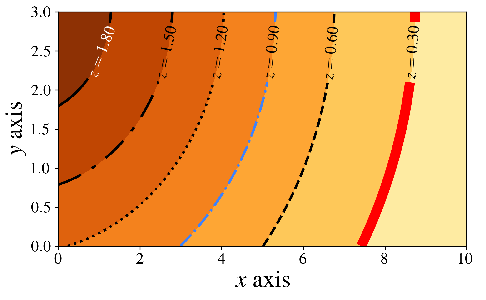

<!-- ------------------------------------- -->
<!-- ------------------------------------- -->

## Least action principle on the beach

[Jupyter notebook](/jupyter/best_path.ipynb){.btn .btn-outline-primary role="button"}

How should ​lifeguard run in order to save a drowning person in minimal time? Answer: by using Snell's law of refraction!  
This is a nice example how to use spines (x and y axis form a cross), instead of rectangular figures as usual. Also, "annotations" are used, where things can be labeled with the help of arrows.  
Main features:
`spines, matplotlib.patches.Rectangle, annotate`

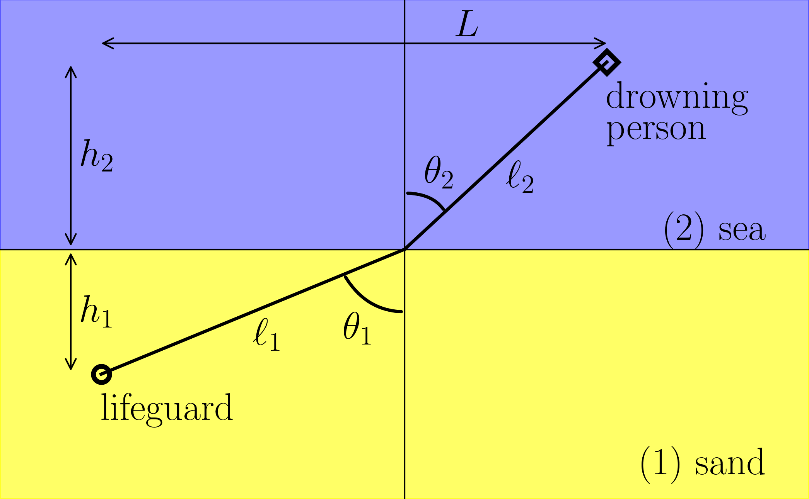

<!-- ------------------------------------- -->
<!-- ------------------------------------- -->

## This website's logo

[Jupyter notebook](/jupyter/website-logo.ipynb){.btn .btn-outline-primary role="button"}

Simple example of how to make a figure without any visible axes.  
Main features:
`set_axis_off, fill_between, matplotlib inline plot on Jupyter`

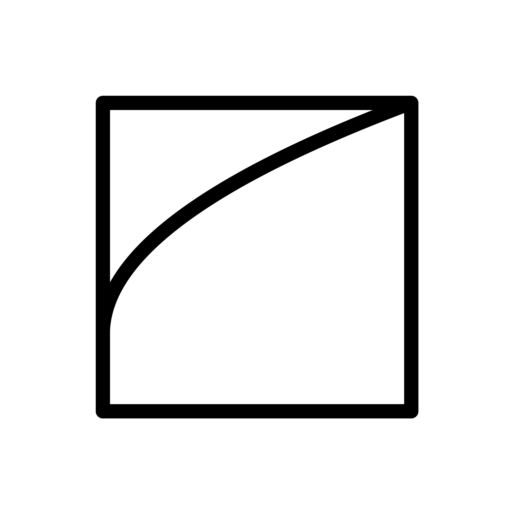

<!-- ------------------------------------- -->
<!-- ------------------------------------- -->

## Logo system

[Jupyter notebook](/jupyter/new_logo.ipynb){.btn .btn-outline-primary role="button"}

The new logo of this website, built from a right triangle with legs 1 and 2, a circle of diameter 1, and the golden ratio. The notebook doubles as the brand document: geometry, orientations, a small-size φ mark, colour, rules of use, and export to SVG, PNG and favicons.  
Main features:
`matplotlib.path.Path, Bezier arcs, compound paths, Affine2D, PIL, SVG export`

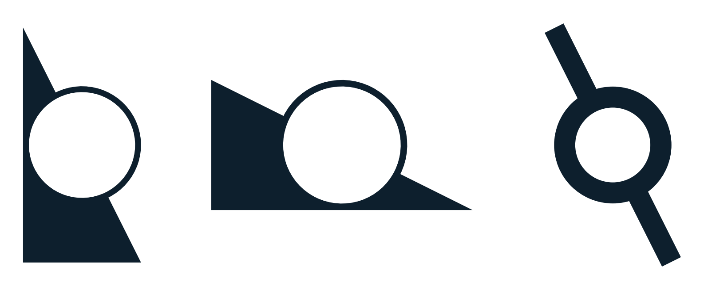

<!-- ------------------------------------- -->
<!-- ------------------------------------- -->

## Bars

[Jupyter notebook](/jupyter/bars.ipynb){.btn .btn-outline-primary role="button"}

Horizontal and vertical bars, with numeric legends. Unicode support.  
Main features:
`unicode, bar, barh, grid`

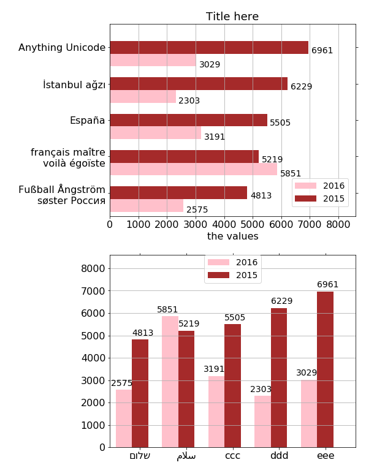

> “The comments aren’t there to explain the code to the programmers, the code is there to explain the comments to the computer.”  
> **—Andy Harris, How to begin thinking like a programmer**
